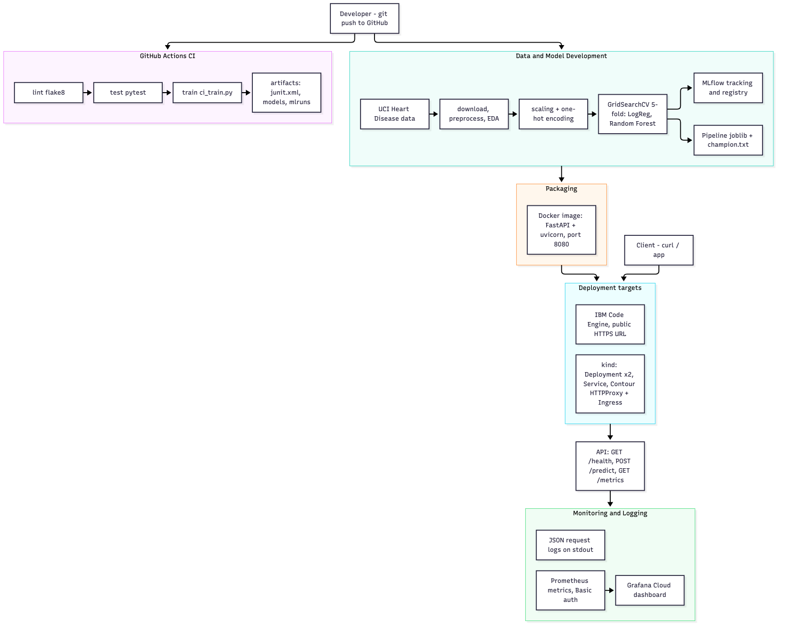

# Heart Disease Risk Prediction — End-to-End MLOps Pipeline

MLOps Assignment 01 (AIMLCZG523). A classifier that predicts heart-disease risk from patient health
data (UCI Heart Disease, Cleveland subset), served as a containerised, monitored REST API.

- **Repository:** https://github.com/ak-eyebee/mlops-a1
- **CI/CD (GitHub Actions):** https://github.com/ak-eyebee/mlops-a1/actions/workflows/ci.yml
- **Live API (IBM Code Engine):** https://heart-disease-api.1s0uu8ax973i.us-south.codeengine.appdomain.cloud
  (`/health` is open; `/predict` and `/metrics` need HTTP Basic auth)
- **Report:** _add link / filename of the final report here_
- **Pipeline video:** _add link / filename here_

## Architecture



Editable source: [`docs/architecture.mmd`](docs/architecture.mmd) (Mermaid).

## Results

Champion model: **Logistic Regression** (selected on test ROC-AUC and recall; see
[`reports/model_selection.md`](reports/model_selection.md)). Full numbers in
[`reports/model_evaluation.json`](reports/model_evaluation.json).

| Model | CV ROC-AUC | Test ROC-AUC | Test Accuracy | Test Precision | Test Recall |
|---|---|---|---|---|---|
| Logistic Regression | 0.9025 | 0.9665 | 0.8852 | 0.8387 | 0.9286 |
| Random Forest | 0.9021 | 0.9502 | 0.8852 | 0.8387 | 0.9286 |

## Repository layout

```
.
├── src/
│   ├── ml_pipeline/
│   │   ├── ci_train.py                                 non-interactive training entry point used by CI
│   │   └── tasks/
│   │       ├── download_data.py, preprocess.py, eda.py     data acquisition, cleaning, EDA
│   │       ├── build_features.py                           ColumnTransformer
│   │       └── train.py, evaluate.py, register_model.py    training, evaluation, MLflow registry
│   └── api/           app.py (FastAPI: /health, /predict, /metrics)
├── tests/             pytest suites: data pipeline, model pipeline, API
├── data/              raw/ and processed/ (cleaned CSV)
├── models/            logreg_model.joblib, rf_model.joblib, champion.txt
├── reports/           EDA figures, model_evaluation.json, model_selection.md
├── deployment/        Kubernetes manifests (kustomize): Deployment, Service, HTTPProxy, Ingress
├── scripts/           populate_grafana.py (traffic generator for the dashboard)
├── docs/              architecture diagram
├── screenshots/       evidence for the report
├── .github/workflows/ci.yml
├── Dockerfile, docker-compose.yml, .dockerignore
├── requirements.txt (dev/training), requirements-serve.txt (runtime image)
└── REPRODUCIBILITY.md
```

## Setup

Requires Python 3.12. Run everything from the repository root.

```bash
python3.12 -m venv .venv
source .venv/bin/activate
pip install -r requirements.txt
```

## Run the pipeline

```bash
# 1. Data acquisition (UCI download, with local fallback)
python -m src.ml_pipeline.tasks.download_data

# 2. Clean + preprocess -> data/processed/heart_disease_cleaned.csv
python -m src.ml_pipeline.tasks.preprocess

# 3. EDA figures -> reports/figures/
python -m src.ml_pipeline.tasks.eda

# 4. Train, tune (GridSearchCV, 5-fold), evaluate and log both models to MLflow
python -m src.ml_pipeline.tasks.evaluate

# 5. Register the champion model in the MLflow Model Registry
python -m src.ml_pipeline.tasks.register_model

# Or the CI-style single command (train + evaluate + register, exits non-zero on failure)
python src/ml_pipeline/ci_train.py
```

## Experiment tracking (MLflow)

All scripts log to the SQLite store `mlflow.db` (experiment `heart-disease-classification`).

```bash
mlflow ui --backend-store-uri sqlite:///mlflow.db
# open http://localhost:5000
```

Each run logs hyper-parameters, CV and test metrics, ROC / confusion-matrix / PR plots and the
fitted sklearn Pipeline. `mlflow.db` and `mlruns/` are git-ignored because they are generated.

## Tests and lint

```bash
flake8 src/ tests/
python -m pytest
```

20 tests across `tests/test_data_pipeline.py`, `tests/test_model_pipeline.py` and `tests/test_api.py`
(including 401 behaviour for unauthenticated `/predict` and `/metrics`). A JUnit report is written to
`reports/junit.xml`.

## CI/CD (GitHub Actions)

[`.github/workflows/ci.yml`](.github/workflows/ci.yml) runs on push / PR to `main`:

`lint (flake8)` → `test (pytest)` → `train (ci_train.py)`

`train` only runs if `lint` and `test` pass, so the pipeline fails on lint or test errors. Each run
uploads `test-results-<sha>`, `trained-models-<sha>` and `mlflow-run-<sha>` as artifacts (30-day retention).

## Serve the model locally (Docker / Podman)

```bash
docker build -t heart-disease-api:local .
docker run --rm -p 8080:8080 \
  -e API_USERNAME=<user> -e API_PASSWORD=<password> heart-disease-api:local
# or: API_PASSWORD=<password> docker compose up --build   (API_USERNAME defaults to admin;
#     both can also go in a git-ignored .env file)
```

`podman` can be substituted for `docker` unchanged. Sample requests:

```bash
curl http://localhost:8080/health

curl -u <user>:<password> -X POST http://localhost:8080/predict \
  -H "Content-Type: application/json" \
  -d '{"age":63,"sex":1,"cp":1,"trestbps":145,"chol":233,"fbs":1,"restecg":2,"thalach":150,"exang":0,"oldpeak":2.3,"slope":3,"ca":0,"thal":6}'
# -> {"prediction": 0|1, "confidence": <probability of disease>}
```

| Endpoint | Auth | Purpose |
|---|---|---|
| `GET /health` | none | liveness + resolved model name |
| `POST /predict` | Basic | prediction and confidence |
| `GET /metrics` | Basic | Prometheus metrics |
| `GET /docs` | none | Swagger UI |

`API_USERNAME` / `API_PASSWORD` fall back to defaults in `src/api/app.py` if unset; always set your own.

## Deployment

**IBM Code Engine (public cloud).** The image is pushed to IBM Container Registry and run as a Code
Engine application with a public HTTPS URL (see the URL above and `screenshots/code_engine_*.png`).

**Kubernetes (kind + Contour).** Manifests in [`deployment/`](deployment/) define a 2-replica
Deployment with probes and resource limits, a ClusterIP Service, and external exposure through a Contour
`HTTPProxy` and a standard `Ingress`. Apply with `kubectl apply -k deployment/`; step-by-step instructions
are in [`deployment/README.md`](deployment/README.md). Set your own credentials in
`deployment/secret.yaml` before applying.

## Monitoring and logging

- Every request is logged as one structured JSON line on stdout (timestamp, method, path, status, latency);
  predictions additionally log the class and confidence.
- `/metrics` exposes Prometheus metrics via `prometheus-fastapi-instrumentator`.
- A Grafana Cloud dashboard visualises request rate and latency.
  [`scripts/populate_grafana.py`](scripts/populate_grafana.py) generates traffic for it.

## Screenshots

Evidence for the report is in [`screenshots/`](screenshots/): Docker build/run, GitHub Actions runs
(including a failing run), Code Engine deployment, Kubernetes resources, logs and Grafana dashboard.
EDA and model plots are in [`reports/figures/`](reports/figures/).

More on reproducibility: [`REPRODUCIBILITY.md`](REPRODUCIBILITY.md).
